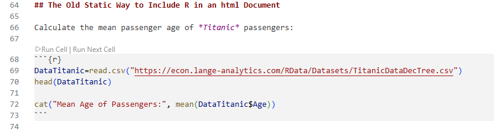
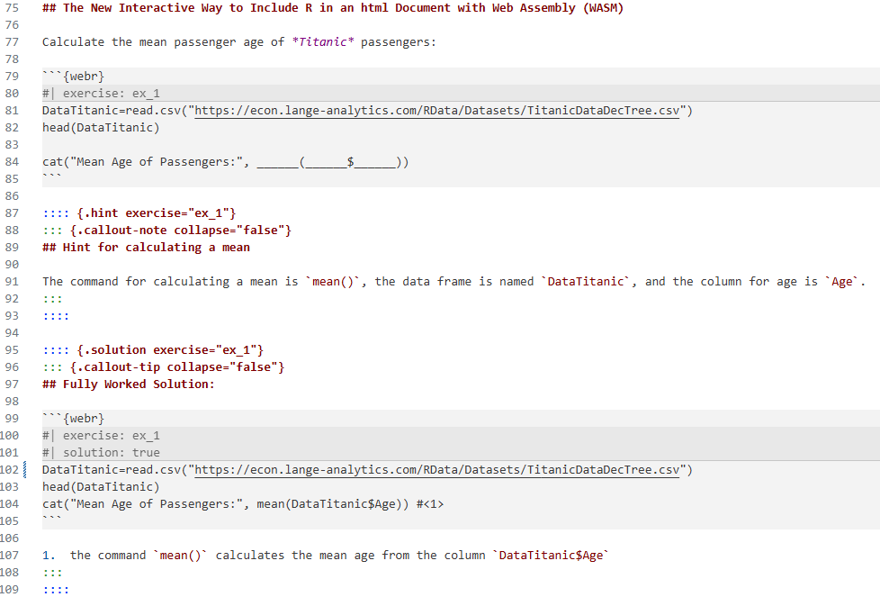
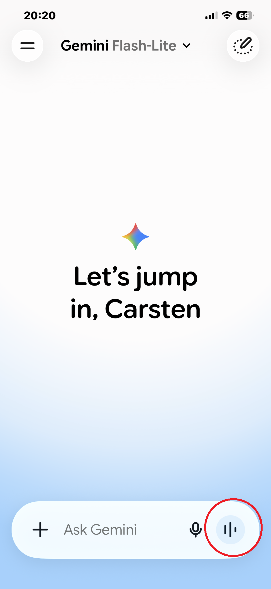
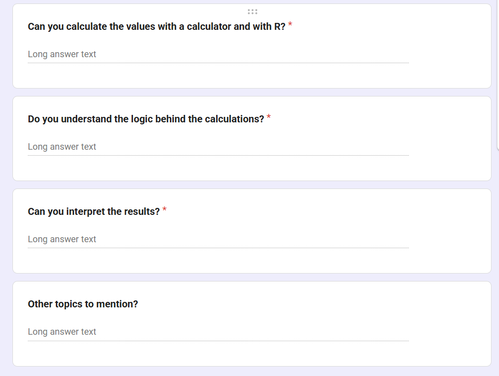





## Overview

1.  **R and Python: Interactivity in a Browser Using Quarto from Posit**

2.  **Demo: Virtual Reality for 3D Regressions**

3.  **GenAI use in Education**

## Running R and Python in a Browser
### No User Setup Required

- Slides with interactive *R* and *Python* code
- Tutorials with interactive *R* and *Python* code
- Quizzes with interactive *R* and *Python* code

## Running R in a Browser

**R is a freely available Statistics Software**

Most commonly *R* is installed together with an IDE (i.e., advanced editor) on a faculty or student's PC

**Link:** [Introduction to R and RStudio](https://ai.lange-analytics.com/htmlbook/RAndRStudio.html){target="_blank"}

## The Old Static Way to Include R in an html Document

Calculate the mean passenger age of *Titanic* passengers:

```{r}
DataTitanic=read.csv("https://econ.lange-analytics.com/RData/Datasets/TitanicDataDecTree.csv")
head(DataTitanic)

cat("Mean Age of Passengers:", mean(DataTitanic$Age))
```

## Quarto Code {visibility="hidden"}

**Similar to a Jupyter Notebook (everything is text if note marked as code)**



## The New Interactive Way to Include R in an html Document with Web Assembly (WASM)

Calculate the mean passenger age of *Titanic* passengers:

```{webr}
#| exercise: ex_1
DataTitanic=read.csv("https://econ.lange-analytics.com/RData/Datasets/TitanicDataDecTree.csv")
head(DataTitanic)

cat("Mean Age of Passengers:", ______(______$______))
```

:::: {.hint exercise="ex_1"}
::: {.callout-note collapse="false"}
## Hint for calculating a mean

The command for calculating a mean is `mean()`, the data frame is named `DataTitanic`, and the column for age is `Age`.
:::
::::

:::: {.solution exercise="ex_1"}
::: {.callout-tip collapse="false"}
## Fully Worked Solution:

```{webr}
#| exercise: ex_1
#| solution: true
DataTitanic=read.csv("https://econ.lange-analytics.com/RData/Datasets/TitanicDataDecTree.csv")
head(DataTitanic)
cat("Mean Age of Passengers:", mean(DataTitanic$Age)) #<1>
```

1.  the command `mean()` calculates the mean age from the column `DataTitanic$Age`
:::
::::

```{webr}
#| exercise: ex_1
#| check: true
gradethis::grade_this_code()
```

## Quarto Code



## Documentation: Interactive html files for R and Python

**Link:** [Docs about WASM with *R* and *Python*](https://r-wasm.github.io/quarto-live/){target="blank_"}

## Creating R Quizzes

**Link:** [Click Here to start quiz](https://econ.lange-analytics.com/HomeworkQLive/auth/login.php?next=../HW9091/HW9091.html){target="_blank"} user: `hawkes2026` pw: `password`

**XX**

# 2) Using VR to Explain Multivariate Regression {.smaller}

{fig-align="center" width="808"}

## Educational Problem with Multivariate Regression

- Simple Regression is 2-dimensional perfect for paper
- Simplest Multivariate Regression is 3D
  - Understanding 3 dimensions on a 2-dimensional paper or screen is challenging
  - This leads to VR with 3 dimensions

## Meta Quest App

### Diagram Exhibition

- **Freely Available:** [https://vr.lange-analytics.com/diagramexh.html](https://vr.lange-analytics.com/diagramexh.html){target="_blank"}
- Various Data Scenario can be displayed (based on an entry code)

- Two Versions for each Data Scenario

  - Narrated by an avatar in the self-learning edition
  - Narrated by an instructor during the classroom session
  
- Data displayed and Regression planes can be changed and adjusted by the student or instructor

## Self-Learner Version Explained in a (shortened) Video

**Link** [Walkthrough Video: I used the app in Self-Learner mode with a Meta Quest VR headset](VideoForSepOct26Presentation.mp4){target="_blank"}

**XXX**

# Using `GenAI` to Support Teaching

1) *GenAI* interacts with students (available for each *Learning Outcome*)
2) *GenAI* assesses course success (on the *Learning Outcome* level)
3) *GenAI* without hallucinations in a clearly defined environment (textbook and syllabus)

## GenAI Educational Innovation Is Interactivity!!!

- books, videos, and even Google searches are one way learning tools:\
  Providing information but no conversations

- GenAI, when used correctly can support a real conversation like between a student and their tutor

## `GenAI` Learning (Teach me about Mean and Median)

::::: columns
::: {.column width="33%"}
{width="222"}
:::

::: {.column width="67%"}
- The following is based on a *Gemini Learning* conversation
- To be visually more appealing two avatars were added with *GenAI*.
  - a cartoon character asking the questions
  - a *wise man* (a *desert hermit brewer* from *HeyGen*)

**Note: The Gemini phone app was used entirely audio-based (2:30).**
:::
:::::

## `GenAI` Learning (Teach me about Mean and Median)

{width="371"}

<audio controls data-autoplay src="1IntroQuestion.wav">

</audio>

## `GenAI` Learning (teach me about Mean and Median)

{width="1111" controls="true" data-autoplay="true"}

## `GenAI` Learning (Teach me about Mean and Median)

{width="371"}

<audio controls data-autoplay src="3PleaseStartMean.wav">

</audio>

## `GenAI` Learning (teach me about Mean and Median)

{width="1111" controls="true" data-autoplay="true"}

## `GenAI` Learning (Teach me about Mean and Median)

{width="371"}

<audio controls data-autoplay src="5StartMedian.wav">

</audio>

## `GenAI` Learning (teach me about Mean and Median)

{width="1111" controls="true" data-autoplay="true"}

## `GenAI` Learning (Teach me about Mean and Median)

{width="371"}

<audio controls data-autoplay src="7AskToRepaetMedian.wav">

</audio>

## `GenAI` Learning (teach me about Mean and Median)

{width="1111" controls="true" data-autoplay="true"}

## `GenAI` Learning (Teach me about Mean and Median)

{width="371"}

<audio controls data-autoplay src="9ConfirmMedian.wav">

</audio>

## `GenAI` Learning (teach me about Mean and Median)

{width="1111" controls="true" data-autoplay="true"}

**XX XX**

## `GenAI` Learning

<br> **`GenAI` will not substitute instructors!**

**`GenAI` will allow us to focus on higher skills, something we always wanted!**

## `GenAI` Learning (Teach Me How to ...)

A `GenAI` tutor is currently used in a Flipped Classroom environment (Intro to Statistics). 

`GenAI` combined with a textbook, videos, and quizzes helps students learn the basics of the course at home.

Later, in the classroom the instructor reviews topics and focusses on higher skills.

**How to start a conversation with the `GenAI` tutor???** 

## Turning Learning Outcomes Into `GenAI` Learning Prompts

1.  [Example](https://learnguide.pythonanywhere.com/learnoutapp/makeguidev2/?SelectedCourseId=clange!cpp.edu!ec3322&Name=Carsten Lange#DescriptiveIc){target="_blank"}

2.  [Tool to generate link](GenerateChatGPTLink.html){target="_blank"} E.g.: 

Explain the concept of Quartiles and Percentiles briefly and encourage students to follow up with more questions about how to calculate the concepts with a calculator or with R. Also offer follow-ups in regards of interpretation and relevance.

# `GenAI` assesses course Learning Outcomes

## Evaluating Learning Outcomes: *Quartiles and Percentiles*

### Google Form for *Quartiles and Percentiles*

In class Google Forms is used to get student feedback for each learning outcome ([Click Here](https://learnguide.pythonanywhere.com/learnoutapp/makeguidev2/?SelectedCourseId=clange!cpp.edu!ec3322&Name=Carsten%20Lange#DescriptiveIc){target="_blank"}):



## Evaluating Learning Outcomes: *Quartiles and Percentiles* {.smaller}

### Question: Calculate Values

```{r}
#| echo: false
library(knitr)

# 1. Define your parameter
sheet_id <- "1ldmsWL7A78341Ht7w_XROnX6ESUo7vKWUC5t_UmD_to"

# 2. Build the CSV URL with a single %s placeholder
csv_url <- sprintf(
  "https://docs.google.com/spreadsheets/d/%s/export?format=csv",
  sheet_id
)

# 3. Read data
DataGoogleSheet <- read.csv(csv_url)
kable(DataGoogleSheet[,3])
```

## Evaluating Learning Outcomes: *Quartiles and Percentiles* {.smaller}

### Question: Understanding the Calculation

```{r}
#| echo: false
kable(DataGoogleSheet[,4])
```

## Evaluating Learning Outcomes: *Quartiles and Percentiles* {.smaller}

### Question: Interpreting the Results

```{r}
#| echo: false
kable(DataGoogleSheet[,5])
```

## Evaluating Learning Outcomes: *Quartiles and Percentiles* {.smaller}

### Question: Other Comments

```{r}
#| echo: false
kable(DataGoogleSheet[,6])
```


## Evaluation in Class (no preparation required)

I created a *Gemini Notebook* and connected it to the Google Form. 

Now I can ask questions about the evaluation. 

**Link:** [Analyzing the data collected with Google Forms](https://gemini.google.com/notebook/92b831a0-c9ad-42ae-8859-b8ecfdd9af61){target="_blank"}

# `GenAI` without Hallucinations in a Clearly Defined Environment

(textbook and syllabus in *Gemini Notebook*)


## Building a Course Assistant for Your Class {.smaller}

**Course Assistants**

[Click for an example (you need a Google account)](https://notebook.google.com/notebook/29e5ca47-19e1-4cbd-961a-129378412f2d/preview){target="_blank" style="color: lightblue !important; font-weight: bold;"}

1.**Access the Platform:** Requires a Google Account. Navigate to [**https://notebooklm.google.com**](https://notebooklm.google.com){target="blank_"} in your browser. If prompted, log in using your standard Google credentials.

2.  **Create a New Notebook:** On the main dashboard, click the large card that says New Notebook (or the + icon). This opens up a completely fresh, empty workspace.

3.  **Upload Your PDFs:** Max 200 MB per file. An Add sources window will automatically pop up. Select Upload files (or drag and drop)

4.  **Add Your Context Note:** Once the PDFs finish loading, click the + (Add source) button in the left panel again, select Note, and paste your routing instructions (telling it when to read Syllabus file versus the Textbook file).

## Thank You All - Your Questions Please

The slides are available at: https://tinyurl.com/langehawkes2026